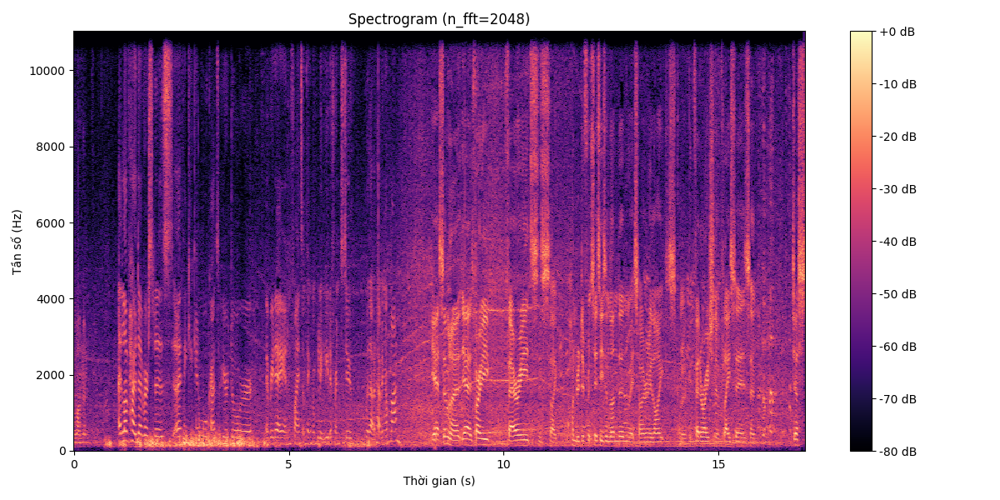
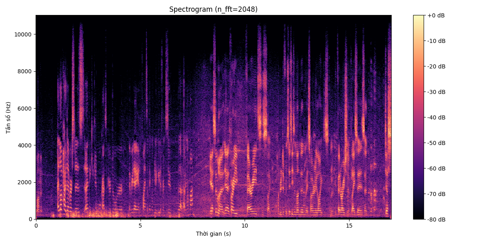

# 🎙️ AI Audio Denoiser — Intelligent Speech Enhancement using Spectral Gating

> **Đề tài:** Ứng dụng trí tuệ nhân tạo trong khử nhiễu âm thanh giọng nói bằng phương pháp Spectral Gating kết hợp xử lý tín hiệu thích ứng.

[](https://python.org)
[](LICENSE)
[]()

---

## 📋 Giới thiệu

Trong lĩnh vực xử lý ngôn ngữ tự nhiên (NLP) và nhận dạng giọng nói (ASR), chất lượng đầu vào âm thanh đóng vai trò quyết định đến độ chính xác của mô hình AI. Tuy nhiên, các bản ghi thu âm thực tế thường bị lẫn nhiều loại nhiễu nền phi tuyến tính như tiếng xe cộ, tiếng gió, tiếng ồn đám đông…

**AI Audio Denoiser** là một pipeline khử nhiễu âm thanh thông minh, kết hợp:

- 🔬 **Lọc thông dải thích ứng (Adaptive Bandpass Filter)** — Loại bỏ các tần số nằm ngoài dải giọng nói con người.
- 🧠 **Spectral Gating dựa trên ước lượng phổ nhiễu tự động** — Thuật toán AI tự học hồ sơ nhiễu (noise profile) từ chính tín hiệu đầu vào, sau đó trừ nhiễu trong miền STFT (Short-Time Fourier Transform).
- ⚖️ **RMS Matching** — Cân bằng năng lượng để đảm bảo âm lượng đầu ra không bị suy giảm.

---

## 🏗️ Kiến trúc hệ thống

```
Input Audio (WAV)
      │
      ▼
┌─────────────────────────┐
│  1. Bandpass Filter      │  Butterworth 6th-order
│     (80 Hz – 8000 Hz)    │  Zero-phase (sosfiltfilt)
└──────────┬──────────────┘
           ▼
┌─────────────────────────┐
│  2. Spectral Gating      │  Non-stationary noise estimation
│     (AI Noise Profile)   │  STFT-domain subtraction
│     prop_decrease=0.85   │  Retain 15% for naturalness
└──────────┬──────────────┘
           ▼
┌─────────────────────────┐
│  3. RMS Matching         │  Loudness normalisation
│     E_out = E_original   │
└──────────┬──────────────┘
           ▼
     Output Audio (WAV)
```

---

## 📊 Kết quả

### Trước khi xử lý (Noisy)


### Sau khi xử lý (AI Denoised)


> 🔍 **Nhận xét:** Sau khi qua pipeline AI, vùng tần số nhiễu nền (các vệt sáng rải rác) đã được loại bỏ đáng kể, trong khi formant của giọng nói (các dải ngang đậm) vẫn được bảo toàn nguyên vẹn.

---

## 🚀 Cài đặt & Sử dụng

### 1. Clone repository

```bash
git clone https://github.com/<your-username>/ai-audio-denoiser.git
cd ai-audio-denoiser
```

### 2. Cài đặt dependencies

```bash
pip install -r requirements.txt
```

### 3. Chạy pipeline

```bash
# Khử nhiễu với tham số mặc định
python main.py -i data/audio.wav -o data/audio_clean.wav

# Tuỳ chỉnh dải tần và cường độ khử nhiễu
python main.py -i data/audio.wav -o data/audio_clean.wav \
    --low 100 --high 6000 --strength 0.9

# Xuất ảnh so sánh spectrogram trước/sau
python main.py -i data/audio.wav -o data/audio_clean.wav \
    --compare assets/comparison.png
```

### 4. Sử dụng trong Python

```python
from src.filter import denoise

denoise("data/audio.wav", "data/audio_clean.wav")
```

---

## 📁 Cấu trúc dự án

```
ai-audio-denoiser/
├── assets/                          # Hình ảnh spectrogram, biểu đồ
│   ├── spectrogram_audio.png
│   └── spectrogram_audio_clean.png
├── data/                            # Dữ liệu âm thanh mẫu
│   ├── audio.wav                    #   Bản ghi gốc (có nhiễu)
│   └── audio_clean.wav              #   Kết quả sau khử nhiễu
├── notebooks/                       # Jupyter Notebooks thí nghiệm
│   ├── noise_filter_demo.ipynb      #   Demo pipeline đầy đủ
│   └── spectral_gating_experiment.ipynb
├── src/                             # Mã nguồn chính
│   ├── __init__.py
│   ├── filter.py                    #   Core denoising engine
│   └── visualise.py                 #   Spectrogram plotting
├── main.py                          # CLI entry-point
├── requirements.txt
├── .gitignore
├── LICENSE
└── README.md
```

---

## 🧪 Tham số có thể tuỳ chỉnh

| Tham số | Mặc định | Mô tả |
| :--- | :---: | :--- |
| `--low` | 80 Hz | Tần số cắt dưới của bandpass filter |
| `--high` | 8000 Hz | Tần số cắt trên của bandpass filter |
| `--strength` | 0.85 | Cường độ khử nhiễu (0.0 = không khử, 1.0 = khử hoàn toàn) |
| `--stationary` | False | Chế độ nhiễu cố định (dùng cho nhiễu đều như quạt máy) |
| `--compare` | — | Đường dẫn xuất ảnh so sánh spectrogram |
| `--spectrogram` | — | Đường dẫn xuất spectrogram riêng file đã lọc |

---

## 📚 Cơ sở lý thuyết

### Spectral Gating

Spectral Gating là một kỹ thuật khử nhiễu trong miền tần số, hoạt động dựa trên nguyên lý:

1. **Ước lượng phổ nhiễu (Noise Profile Estimation):** Thuật toán phân tích toàn bộ tín hiệu để xây dựng mô hình thống kê của nhiễu nền — tương tự cách một mạng neural học biểu diễn đặc trưng (feature representation) từ dữ liệu.

2. **Tạo mặt nạ tần số (Spectral Mask):** Với mỗi khung thời gian (frame) trong biến đổi STFT, thuật toán so sánh biên độ phổ với ngưỡng nhiễu đã ước lượng để tạo ra một "soft mask" — quyết định giữ lại hay loại bỏ từng thành phần tần số.

3. **Áp dụng mặt nạ & tái tổng hợp:** Mặt nạ được nhân với phổ STFT, sau đó tín hiệu được tổng hợp ngược (inverse STFT) để thu được dạng sóng sạch.

### Bandpass Filter

Bộ lọc Butterworth bậc 6 được chọn vì đáp ứng tần số phẳng tối đa trong dải thông, giảm thiểu hiện tượng ripple. Dải 80–8000 Hz bao phủ toàn bộ phổ giọng nói con người (F0 ~ 85–255 Hz, formants lên đến ~5000 Hz).

---

## 🛠️ Công nghệ sử dụng

- **Python 3.10+**
- **NumPy** — Tính toán ma trận, xử lý tín hiệu số
- **SciPy** — Thiết kế bộ lọc Butterworth
- **Librosa** — Phân tích âm thanh, STFT, spectrogram
- **Noisereduce** — Thuật toán Spectral Gating
- **SoundFile** — Đọc/ghi file WAV
- **Matplotlib** — Trực quan hoá kết quả

---

## 📄 License

Dự án được phân phối dưới giấy phép [MIT License](LICENSE).

---

## 🤝 Đóng góp

Mọi đóng góp đều được hoan nghênh! Vui lòng tạo Issue hoặc Pull Request.

1. Fork repository
2. Tạo nhánh feature (`git checkout -b feature/ten-tinh-nang`)
3. Commit thay đổi (`git commit -m "Add: mô tả thay đổi"`)
4. Push lên nhánh (`git push origin feature/ten-tinh-nang`)
5. Tạo Pull Request
